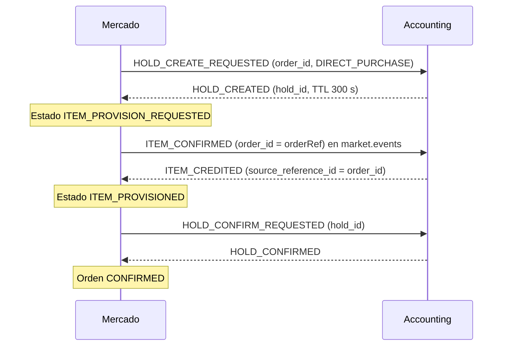
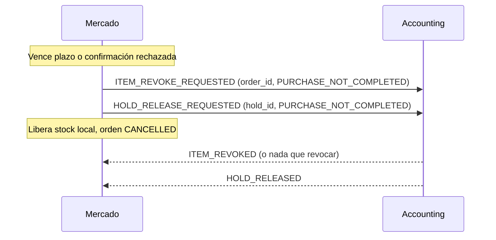

# DEC-025 - Saga de compra de ítems según la Propuesta C

> Se adopta la Propuesta C para la compra directa de ítems: retener fondos, acreditar el ítem (`ITEM_CONFIRMED` → `ITEM_CREDITED`) y recién después confirmar el débito (`HOLD_CONFIRM_REQUESTED` → `HOLD_CONFIRMED`); ante vencimiento del plazo de confirmación o fallo posterior, Mercado ejecuta rollback completo con `ITEM_REVOKE_REQUESTED`. Cierra [[Q-008 - Orden de la saga de compra]] y sustituye a [[DEC-019 - La unidad de una compra HOLD_NOT_SETTLED queda retenida]] para nuevas compras directas.

## Contexto
La compra directa requería coordinar dos pasos en Accounting: confirmar el débito del [[Hold de monedas]] y acreditar el ítem en el inventario del estudiante. Históricamente existían tres órdenes en conflicto:
1. **Orden A (código inicial de Mercado):** Provisión interna (`ITEM_PROVISION_*`) y luego confirmación del débito. Usaba mensajes que Accounting no conocía y dejaba órdenes trabadas.
2. **Orden B (modelo de Accounting):** Confirmar el débito primero y luego publicar `ITEM_CONFIRMED`. Presentaba el riesgo crítico de cobrar sin entregar si el crédito fallaba, sin mecanismo de reembolso automático.
3. **Orden C (recomendación D2 y D9 del taller):** Acreditar el ítem primero y confirmar el débito después.

La pregunta abierta [[Q-008 - Orden de la saga de compra]] evaluaba estos tres caminos. Con la formulación de la [[Propuesta C de la saga de compra]], el equipo diseñó un mecanismo de rollback completo por plazo que neutraliza el riesgo de entregar sin cobrar (si el débito falla o expira, se revoca el ítem entregado, se libera el hold y se reintegra el stock reservado). El Product Owner y coordinador Tomás Kimmel confirmó la adopción de la Propuesta C para las compras directas de ítems (US-7697).

## Decisión
Confirmada por Tomás Kimmel (PO / coordinador) el 2026-10-12 (US-7697).

### 1. Secuencia de la saga para compras directas de ítems
El flujo exitoso sigue estrictamente la secuencia de la Propuesta C:
1. **Retención:** Mercado solicita `HOLD_CREATE_REQUESTED` a Accounting; Accounting responde `HOLD_CREATED`.
2. **Espera de crédito:** Mercado avanza su estado interno a `ITEM_PROVISION_REQUESTED` y publica `ITEM_CONFIRMED` en `market.events` con el UUID canónico `orderRef` como `order_id`, el productor `market-service` y los atributos de la oferta.
3. **Acreditación:** Accounting acredita el ítem en el inventario del estudiante y publica `ITEM_CREDITED` en `accounting.events`, correlacionado por `source_reference_id = order_id`.
4. **Transición y cobro:** Al recibir `ITEM_CREDITED`, Mercado transiciona internamente a `ITEM_PROVISIONED` y emite `HOLD_CONFIRM_REQUESTED` en `accounting.events`.
5. **Cierre:** Accounting debita las monedas y responde `HOLD_CONFIRMED`; Mercado transiciona la orden a `CONFIRMED`.



### 2. Semántica de los estados internos
Los estados `ITEM_PROVISION_REQUESTED` e `ITEM_PROVISIONED` se preservan en la máquina de estados de la [[Orden de compra]] como costuras internas para evitar migraciones disruptivas del `CHECK` constraint de `OrderStatus` en PostgreSQL (`ddl-auto=update` no modifica restricciones de enum). En la T01 (PR #179 de `tpi-market`) se eliminaron los clientes y listeners salientes a Inventario; no existe transporte externo de `ITEM_PROVISION_*`.

### 3. Plazos de confirmación y jobs de vencimiento y reconciliación
Para evitar que un retardo en Kafka o Accounting provoque confirmaciones sobre holds ya vencidos:
- **Plazo de corte para confirmación:** Para órdenes en `ITEM_PROVISION_REQUESTED`, el plazo límite para confirmar es `holdExpiresAt` menos un margen de seguridad (por defecto 90 segundos; propiedad `purchase.confirmation-deadline.margin-seconds: 90`). Si `ITEM_CREDITED` llega después de ese plazo, no se confirma el débito y se dispara la compensación (`CONFIRMATION_DEADLINE_EXCEEDED`).
- **Plazo para órdenes provisionadas:** Para órdenes en `ITEM_PROVISIONED` (cuyo `HOLD_CONFIRM_REQUESTED` ya fue emitido), se consideran vencidas al expirar `holdExpiresAt`.
- **Job de chequeo de deadlines (`purchase.confirmation-deadline.*`):** Habilitado por defecto (`purchase.confirmation-deadline.enabled=true`), corre con un intervalo de 15 segundos (`fixedDelayString=15000`) y procesa en lotes de hasta 50 órdenes (`purchase.confirmation-deadline.batch-size: 50`). Identifica órdenes vencidas y consulta el estado del hold en Accounting (`GET /api/accounting/holds/{holdId}`) fuera de transacciones locales:
  - `COMMITTED`: Mercado confirma la orden (`CONFIRMED`).
  - `PENDING` o `RELEASED`: Mercado ejecuta compensación (`rollback`).
  - `UNKNOWN`, error de red o falta de coincidencia de identidad: se reintenta hasta que el vencimiento supere una ventana acotada (por defecto 600 segundos; `purchase.confirmation-deadline.review-delay-seconds: 600`).
  - **Revisión administrativa (`HOLD_VERIFICATION_UNRESOLVED`):** Superada la ventana de reintentos sin resultado concluyente, la orden se marca con `review_reason = 'HOLD_VERIFICATION_UNRESOLVED'`. Se excluye de escaneos automáticos posteriores y preserva el estado y las reservas de stock para resolución de un ADMIN.
- **Job de reconciliación periódica (`bank-hold.reconciliation.*`):** Job separado, deshabilitado por defecto (`bank-hold.reconciliation.enabled=false`), que corre periódicamente cada 60 segundos (`fixedDelayString=60000`) como salvaguarda general sobre holds pendientes.

### 4. Rollback completo y contrato de revocación (`ITEM_REVOKE_REQUESTED`)
Cuando una compra directa se cancela tras haber emitido `ITEM_CONFIRMED` (por vencimiento del plazo, confirmación rechazada, o eventos autoritativos externos `HOLD_RELEASED`/`HOLD_EXPIRED`):
1. **Revocación del ítem:** Mercado emite `ITEM_REVOKE_REQUESTED` hacia Accounting con el contrato congelado:
   ```json
   {
     "correlation_id": "<UUID del event_id del envelope>",
     "order_id": "<orderRef UUID canónico>",
     "student_id": "<estudiante de la compra>",
     "course_id": "<curso de la compra>",
     "revoke_reason": "PURCHASE_NOT_COMPLETED"
   }
   ```
   Tópico: `accounting.events`, clave de partición: `student_id:course_id`, productor: `market-service`, envelope versión 1 (`contratos-kafka v8`).
2. **Liberación del hold:** Mercado solicita `HOLD_RELEASE_REQUESTED` con motivo `PURCHASE_NOT_COMPLETED` (salvo que la compensación provenga de un evento autoritativo de liberación ya emitido por Accounting).
3. **Liberación de stock:** Mercado libera la reserva local de stock (`stockReservationId`).
4. **Estado terminal:** La orden pasa a `CANCELLED`.
5. **Guarda de identidad histórica (`REVOKE_IDENTITY_UNRESOLVED`):** Si una orden histórica de ítem directo carece de `orderRef` UUID, se marca de inmediato con `review_reason = 'REVOKE_IDENTITY_UNRESOLVED'` antes de compensar, preservando el estado de la compra, el hold y el stock, sin inventar identificadores UUID ni enviar identificadores numéricos a Accounting.



### 5. Sustitución de DEC-019 (`HOLD_NOT_SETTLED`)
[[DEC-019 - La unidad de una compra HOLD_NOT_SETTLED queda retenida]] disponía que una orden cancelada por `HOLD_NOT_SETTLED` retuviera la unidad de stock en cuarentena indefinida para no sobrevender, dado que el ítem quedaba en poder del estudiante.
- **Sustitución:** Para nuevas órdenes directas bajo la Propuesta C adoptada, DEC-025 sustituye a DEC-019. Al existir el rollback con revocación (`ITEM_REVOKE_REQUESTED`), el ítem se revoca en Accounting y la unidad de stock vuelve a liberarse en Mercado.
- **Compatibilidad histórica:** Las filas históricas persistidas con `HOLD_NOT_SETTLED` y las vistas/reportes existentes se preservan sin modificaciones.

### 6. Alcance respecto a la compra de vidas (LIFE)
La compra de vidas queda **excluida** de la revocación de ítems.
- En este sprint, la compra de vidas mantiene su circuito transicional: validación preventiva de tope, retención, confirmación directa del hold y publicación posterior de `LIFE_PURCHASE_CONFIRMED`.
- En este sprint únicamente se detecta crédito parcial o insuficiente al recibir `LIFE_CREDITED` (T08, PR #187, mergeado en `develop@d3b7a4de`) y se marca para revisión de un ADMIN con `review_reason = 'LIFE_CREDIT_SHORTFALL'`.
- La saga completa de vidas (crédito previo al débito) se difiere para el siguiente sprint. **No se adopta ningún acuerdo de saga completa de vidas para este sprint.**

### 7. Formato de cable Kafka: migración a `snake_case` (contratos-kafka v8)
- **Alineación de plataforma:** El formato de cable Kafka para el flujo de compras de Mercado adopta `snake_case`, alineado con la especificación oficial `contratos-kafka v8`:
  - Envelope: `event_id`, `event_type`, `event_version`, `timestamp`, `producer`, `payload`.
  - Campos de los payloads: estrictamente en `snake_case` (`order_id`, `student_id`, `course_id`, `correlation_id`, `source_reference_id`, `revoke_reason`, etc.).
- **Estado en Accounting:** Accounting en su rama `develop` (`tpi-accounting@10e31d85`, 2026-10-11) ya publica y lee exclusivamente en `snake_case`.
- **Estado en Mercado:** Migración a `snake_case` según `contratos-kafka v8` mergeada en `develop@d3b7a4de` (PR #186).

### 8. Puntos pendientes y condiciones externas
- **Ratificación de Accounting:** El contrato de `ITEM_REVOKE_REQUESTED` está congelado del lado de Mercado pero pendiente de ratificación de Accounting.
- **Esquemas de respuesta propuestos (consumidores implementados en Mercado y mergeados en `develop@d3b7a4de` vía PR #188, T05; pendientes de ratificación por Accounting):**
  - `ITEM_CREDIT_FAILED` `{student_id, course_id, source_reference_id, reason, message}`: cancela la orden con motivo `ITEM_CREDIT_FAILED`, libera el stock reservado y libera el hold sin revocar ítem.
  - `ITEM_REVOKED` `{correlation_id, order_id, student_id, course_id, revoked_item_count}`: confirmación idempotente de revocación (`revoked_item_count = 0` indica "nada que revocar").
  - `ITEM_REVOKE_FAILED` `{correlation_id, order_id, student_id, course_id, reason, message}`: marca `ITEM_REVOKE_FAILED` en revisión administrativa (`review_reason`), emite log `ERROR` e incrementa la métrica `market.purchase.revoke_failed{reason}`. Además, de forma independiente establece la bandera booleana `revoke_failed = true` en la tabla `orders` (mediante `PurchaseReviewService.markRevokeFailed`), la cual se marca siempre ante un fallo de revocación aunque la orden ya tuviera otro motivo de revisión asignado.
- **Garantías requeridas en Accounting:** Idempotencia ante revocación ("nada que revocar") y bloqueo de créditos tardíos si `ITEM_CONFIRMED` se procesa tras `ITEM_REVOKE_REQUESTED`.
- **Scripts SQL manuales de base de datos:** Antes del deploy a entornos con PostgreSQL deben ejecutarse manualmente los 3 scripts SQL ubicados en `db/manual/` para actualizar las restricciones y columnas de la tabla `orders`:
  1. `US7697__order_review_reason.sql`: agrega la columna `review_reason` y su restricción `CHECK`.
  2. `US7697__orders_cancellation_reason_check.sql` (T03): amplía la restricción `CHECK` de motivos de cancelación para admitir `CONFIRMATION_DEADLINE_EXCEEDED`.
  3. `US7697__orders_revoke_failed_flag.sql` (T05): agrega la bandera booleana `revoke_failed` en la tabla `orders`.

## Alternativas descartadas
- **Orden B (débito primero, según Accounting):** Descartado porque cobra al alumno antes de asegurar la acreditación del ítem y carece de reembolso automático.
- **Orden A histórico (provisión simulada):** Descartado porque usaba mensajes de Inventario inexistentes en la plataforma.
- **Conservar DEC-019 para compras nuevas:** Descartado; retenía unidades vendibles de por vida y permitía que los estudiantes conservaran ítems impagos.
- **Implementar saga completa de vidas este sprint:** Descartado; la política de vidas de Accounting (clamp a maxLives) y el manejo de cap exigen acuerdos bilaterales aún no alcanzados.

## Consecuencias
- Cierra formalmente la pregunta [[Q-008 - Orden de la saga de compra]].
- La nota [[Propuesta C de la saga de compra]] pasa de borrador a guía vigente.
- Actualiza la máquina de estados y diagramas de la [[Orden de compra]] y de la [[Integración con Accounting]].
- Define los contratos asíncronos en [[Eventos y Kafka]].
- Código de Mercado (`tpi-market` en `develop@d3b7a4de`): se encuentran completamente integrados y mergeados T01 (PR #179, reordenamiento de saga), T02 (PR #189, publicación de `ITEM_CONFIRMED` con UUID canónico), T03 (PR #182, plazos de confirmación), T04 (PR #184, rollback atómico y cliente de revocación), T05 (PR #188, consumidores de fallos de crédito y revocación, flag `revoke_failed`, métrica `market.purchase.revoke_failed`), T08 (PR #187, detección de crédito insuficiente en vidas `LIFE_CREDIT_SHORTFALL`) y la migración de wire format Kafka a `snake_case` según `contratos-kafka v8` (PR #186). Los ítems de ratificación de Accounting permanecen pendientes.

## Notas afectadas
[[Q-008 - Orden de la saga de compra]], [[Propuesta C de la saga de compra]], [[Decisiones - Índice]], [[Integración con Accounting]], [[Eventos y Kafka]], [[Orden de compra]], [[Hold de monedas]], [[Saga]], [[DEC-019 - La unidad de una compra HOLD_NOT_SETTLED queda retenida]], [[Taller de decisiones]], [[Roadmap de trabajo]], [[Roadmap de entendimiento]], [[Contrato de avisos de compra]].
