# Flujos de compra directa y subasta

> Todos los casos de la compra directa y de la subasta contra Accounting, incluidos los de error, con la intervención de la saga y el outbox. Incluye el contrato de subastas que Mercado le propone a Accounting y qué pasa cuando falla cada servicio. La compra directa está en el código; la subasta es una propuesta sin código.

La compra directa sigue la saga de [[DEC-025 - Saga de compra de ítems según la Propuesta C]] y está implementada. La subasta parte del diseño del spike [[S2-09c - SPIKE Diseño técnico de subastas]] (ver [[Subasta]]) y todavía no tiene código.

Verificado contra `tpi-market@d3b7a4de`, `tpi-accounting@c8c4405a` y `tpi-course@092b117e` (ramas `develop`, 2026-10-14).

## Estado vigente: retiro definitivo y acuerdo publicado (2026-10-17)

[[DEC-032 - Retiro definitivo y contrato de holds de subastas]] sustituye la discusión anterior: el alumno retira, recupera el disponible sin cobro y no puede volver a pujar. Mercado bloquea antes de otro create; HOLD_ALREADY_EXISTS es defensa adicional. HOLD_RELEASE_REQUESTED usa AUCTION_BID_WITHDRAWN, todavía pendiente de incorporación al enum de Accounting. El hold queda RELEASED definitivamente; las mejoras de una oferta activa reutilizan PENDING. Los límites de fase no aprobados del spike siguen siendo propuesta.

[Respuesta aprobada y publicada](https://github.com/2026-P4-BE/tpi-market/issues/200#issuecomment-6244678432). El usuario aceptó TTL configurable de 16 días y rechazo de confirmaciones vencidas con INVALID_HOLD_STATE. [[Q-028 - Retiro y re-oferta frente al ciclo del hold]] quedó archivada por la decisión funcional, sin afirmar implementación del motivo pendiente.

La baja libera con ACCOUNT_DEACTIVATED, correlation_id nulo y sin doble release. Se confirman payload HOLD_INCREASED, diez rechazos comunes y studentId:courseId para operaciones por postor. La extensión por orden usa key order_id y no cambia endsAt ni recupera expirados. Detalle y fuentes en [[Seguimiento con Accounting - Subastas y holds]]. No cambian dado vigente, saga C ni acuerdos de meta colectiva.

Las secciones anteriores y siguientes que describen retiro con re-oferta o pendientes ya confirmados se conservan como historial superado por esta decisión.

## Actualización con Accounting (2026-10-17)

[[Seguimiento con Accounting - Subastas y holds]] registra las respuestas recibidas y la aclaración de Mercado. El usuario reporta que Hernán confirmó permitir retiro y re-oferta; Accounting los excluyó usando el PRD anterior. Discrepancia y mecanismo de reingreso abiertos en [[Q-028 - Retiro y re-oferta frente al ciclo del hold]]. Aumentar reutiliza el mismo hold PENDING mediante `HOLD_INCREASE_REQUESTED` / `HOLD_INCREASED`; no acredita reabrir RELEASED.

Accounting informa que la baja libera con `ACCOUNT_DEACTIVATED`, sin `AUCTION_BIDDER_UNENROLLED`, y anuncia `HOLD_EXPIRY_EXTEND_REQUESTED` / `HOLDS_EXPIRY_EXTENDED` para PENDING por orden, solo alargando y con tope; payload final pendiente de AsyncAPI. Quedan por responder TTL de 16 días, rechazos, payload de HOLD_INCREASED y clave `studentId:courseId`. Rechazar confirmaciones vencidas con INVALID_HOLD_STATE está en evaluación. Extender holds no modifica el cierre fijo de DEC-014.

Las secciones siguientes conservan sus verificaciones históricas; esta actualización supera pedidos anteriores de motivo por baja y ausencia de comando de extensión. No acredita despliegue ni ratifica la saga C para subastas. La propuesta detallada está en [[Flujos de compra directa y subasta]].

## Cómo leer los diagramas

- Cada **Tx** es una transacción local de Mercado: la [[Saga]] cambia su estado y escribe el comando en `outbox_events` en la misma transacción, así que nunca queda un estado sin mensaje ni un mensaje sin estado ([[Patrón Outbox]]).
- El relay (`OutboxRelayJob`, cada 2 s) publica las filas pendientes y entrega al menos una vez.
- Cada respuesta de Accounting se registra en `processed_events` dentro de la transacción que aplica su efecto, así que un duplicado se descarta sin efecto ([[Entrega at-least-once y deduplicación]]).
- Los comandos de holds y sus respuestas viajan por `accounting.events`; `ITEM_CONFIRMED` va por `market.events` ([[DEC-009 - Contrato de holds e ítems según Accounting]]).

Etiquetas de cada caso: **en el código** (verificado en `tpi-market`), **propuesta** (diseño sin código) y **abierto** (sin resolver).

## Compra directa

### D1 · Compra exitosa (en el código)

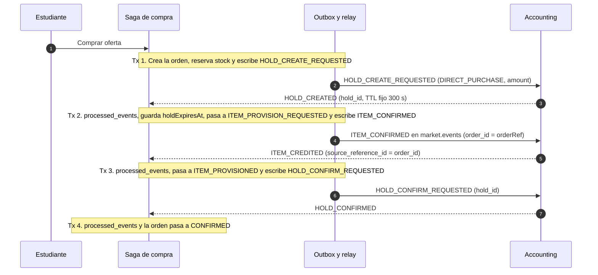

El plazo para cobrar es `holdExpiresAt` − 90 s (`purchase.confirmation-deadline.margin-seconds` en `src/main/resources/application.properties`), unos 210 s después de crear el hold. Detalle en [[Propuesta C de la saga de compra]] y [[Orden de compra]].

### D2 · Accounting rechaza el hold (en el código)

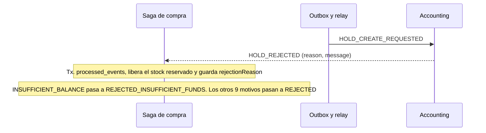

No se cobró nada, así que no hay nada que compensar en Accounting.

### D3 · El hold vence antes de entregar el ítem (en el código)

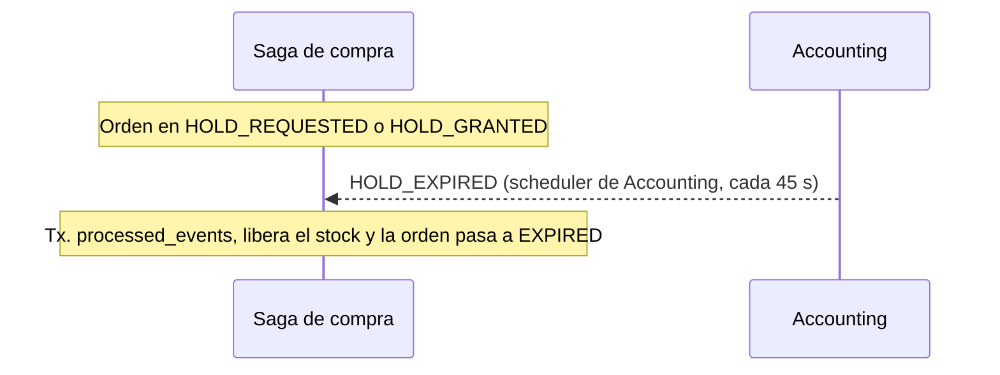

Accounting ya liberó el hold por su cuenta (`TTL_EXPIRED`), así que Mercado no envía ningún comando.

### D4 · Accounting no puede acreditar el ítem (en el código)

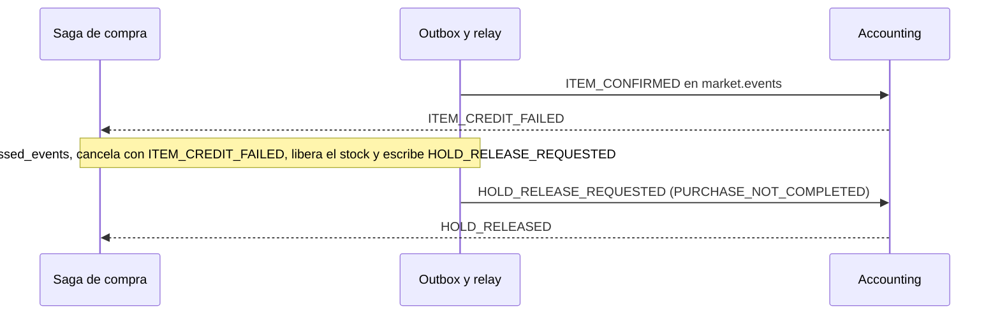

No hay ítem que revocar porque nunca se acreditó (`services/impl/OrderItemProvisionServiceImpl.java`, `cancelAndReleaseHold`).

### D5 · Se pasa el plazo sin cobrar (en el código)

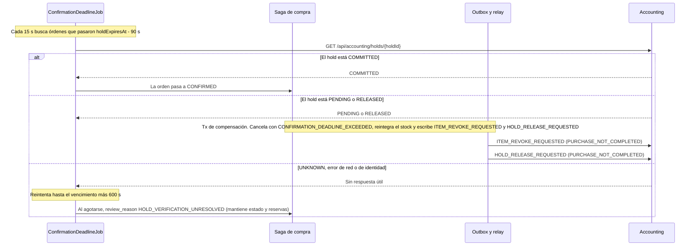

Si el ítem ya se había acreditado se revoca; si todavía no, la revocación no encuentra nada que quitar.

### D6 · Falla el cobro con el ítem ya acreditado (en el código)

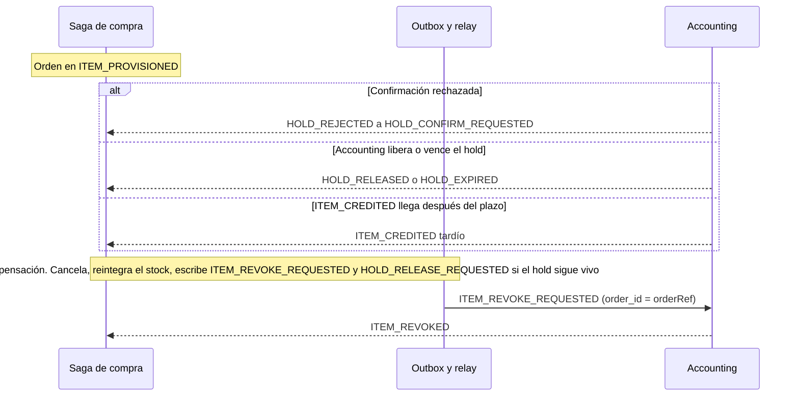

Si la orden es histórica y no tiene `orderRef`, no se compensa y queda en revisión con `REVOKE_IDENTITY_UNRESOLVED`.

### D7 · Falla la revocación del ítem (en el código)

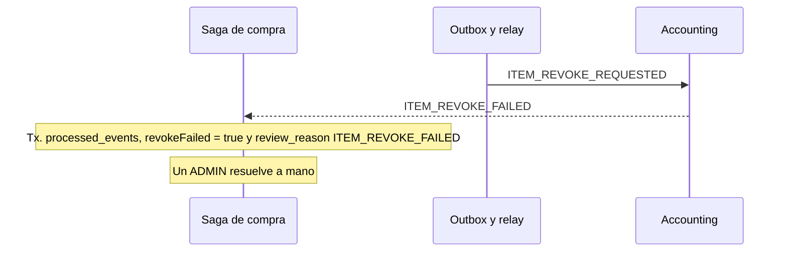

La orden ya está cancelada; la marca sirve para que el estudiante no se quede con un ítem que no pagó.

## Subasta

### S1 · Subasta con ganador (propuesta)

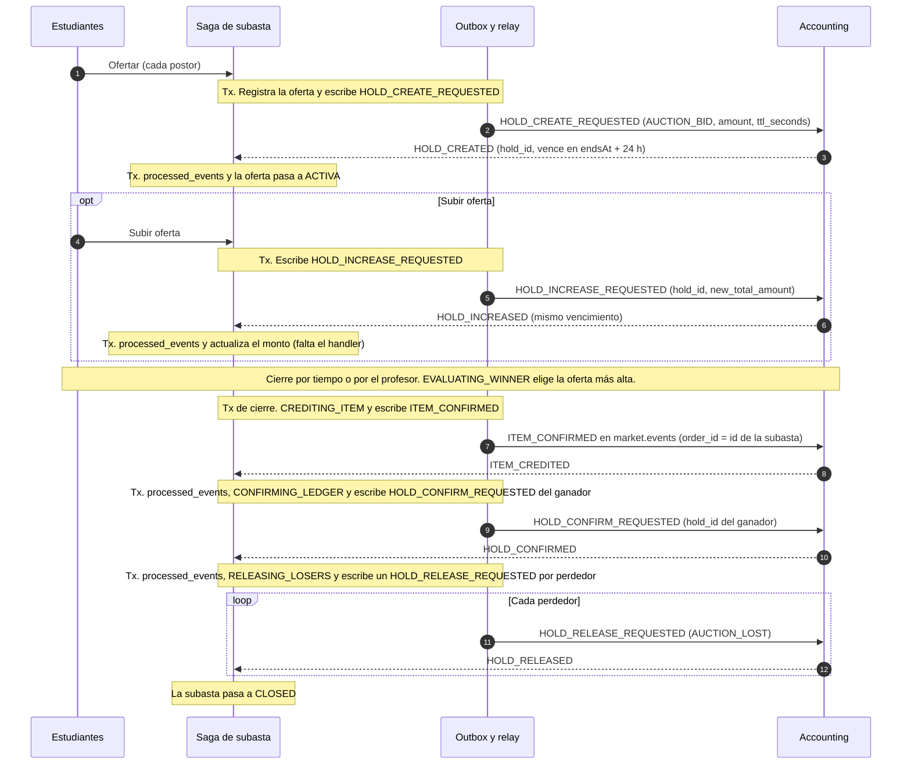

Si hay empate en el monto más alto, rige el dado de [[DEC-014 - Reglas de subastas]] mientras [[Q-025 - Desempate de las subastas]] siga abierta.

### S2 · Accounting rechaza una oferta (propuesta)

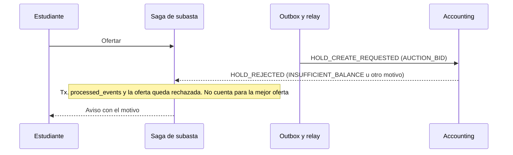

Mientras el hold no esté creado, la oferta no puede ser la mejor: la saga solo cuenta ofertas `ACTIVA`.

### S3 · Accounting rechaza una subida (propuesta)

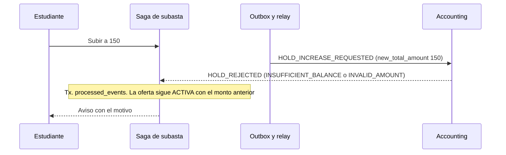

Accounting exige que el total nuevo sea mayor que el actual y que el hold siga `PENDING`.

### S4 · Retiro definitivo (decidido; integración pendiente)

[[DEC-032 - Retiro definitivo y contrato de holds de subastas]]: el alumno retira, Mercado lo excluye y recalcula ofertas elegibles. Emite HOLD_RELEASE_REQUESTED(AUCTION_BID_WITHDRAWN); Accounting confirma HOLD_RELEASED y el monto vuelve al disponible sin cobro, sin esperar al cierre. El hold queda RELEASED para siempre. El alumno no puede volver a pujar: Mercado rechaza antes del create; HOLD_ALREADY_EXISTS es defensa adicional.

AUCTION_BID_WITHDRAWN todavía falta en el enum de Accounting. Las mejoras S1/S3 sí reutilizan PENDING. Los límites de fase del spike todavía no aprobados siguen como propuesta.
### S5 · Subasta sin ofertas (propuesta)

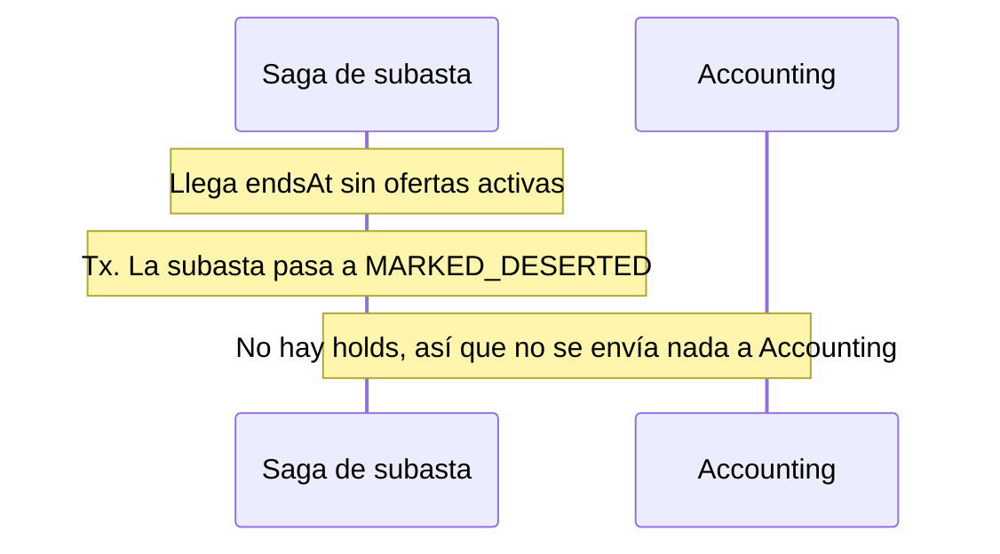

Solo se avisa al profesor.

### S6 · Se cancela la subasta (propuesta)

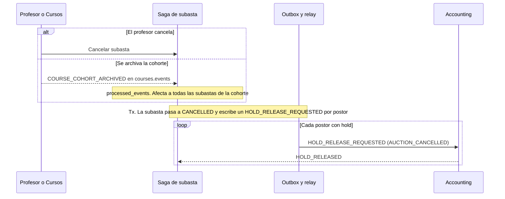

Nunca un release por `order_id`: siempre uno por postor ([[DEC-014 - Reglas de subastas]]). Las subastas en `DRAFT` o `SCHEDULED` se cancelan sin mensajes.

### S7 · Un postor se da de baja del curso (propuesta)

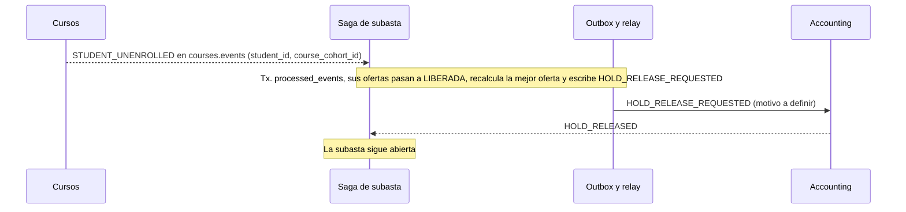

Accounting también consume `STUDENT_UNENROLLED`; falta confirmar si libera el hold por su cuenta (`ACCOUNT_DEACTIVATED`) y evitar un doble release.

### S8 · Falla la liquidación del ganador (propuesta)

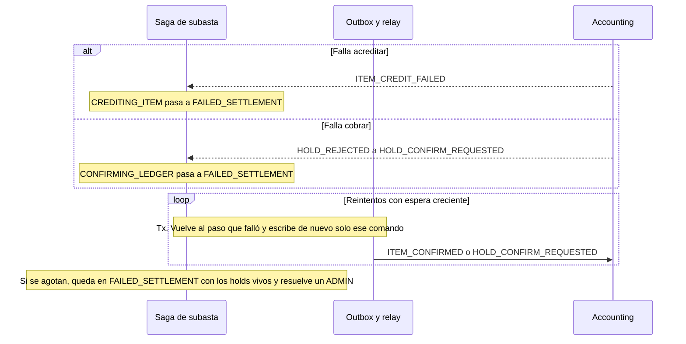

La subasta no se cancela: el cierre es un hecho consumado. Si el ítem ya se acreditó, no se vuelve a acreditar. La cantidad de reintentos está abierta.

### S9 · El hold del ganador vence antes de liquidar (abierto)

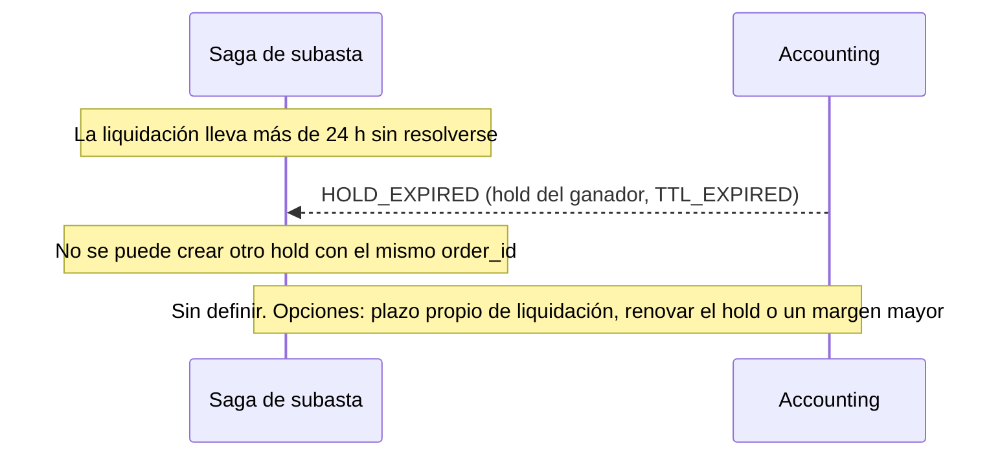

El margen de 90 s de la compra directa no sirve acá: con un hold de días caería un día después del cierre.

## Qué cambia entre una y otra

| Aspecto | Compra directa | Subasta |
|---|---|---|
| Participantes | Un estudiante | Todos los estudiantes del curso y cohorte que oferten |
| `order_type` | `DIRECT_PURCHASE` | `AUCTION_BID` |
| `order_id` | `orderRef` de la orden (UUID) | Id de la subasta; un hold por postor con el mismo `order_id` |
| Duración del hold | 300 s fijos, decididos por Accounting | `ttl_seconds` = hasta `endsAt` + 24 h (sin máximo en Accounting) |
| Plazo para cobrar | `holdExpiresAt` − 90 s | Sin definir (S9) |
| Aumento del monto | No aplica | `HOLD_INCREASE_REQUESTED` con el total nuevo; no extiende el vencimiento |
| Quién se cobra | El comprador | Solo el ganador; a los perdedores se les libera el hold con `AUCTION_LOST` |
| Si falla el cobro | Rollback: revoca el ítem, libera el hold y reintegra el stock | Reintentos; al agotarlos, `FAILED_SETTLEMENT` a la espera de un ADMIN |
| Cancelación | `PURCHASE_NOT_COMPLETED` | Un release por postor con `AUCTION_CANCELLED` |
| Stock | Reserva y suma a `unitsSold` | No reserva ni suma |
| Eventos de Cursos | No los consume | `COURSE_COHORT_ARCHIVED` y `STUDENT_UNENROLLED` |

## Contrato de subastas para Accounting

Lo que Mercado le propone a Accounting para las subastas. Reutiliza los mensajes que Accounting ya implementa para `AUCTION_BID` (código de `tpi-accounting@c8c4405a`) y marca lo que falta acordar. Ningún mensaje es nuevo: lo nuevo son dos motivos de release y algunas garantías. Ver también [[Integración con Accounting]].

### Sobre y transporte

| Campo | Tipo | Regla |
|---|---|---|
| `event_id` | UUID | Único por mensaje. Mercado lo reutiliza si republica el mismo comando. Accounting lo devuelve como `correlation_id` en la respuesta |
| `event_type` | texto | Nombre del comando o evento |
| `event_version` | entero | `1` |
| `timestamp` | ISO-8601 UTC | Momento de escritura en el outbox |
| `producer` | texto | `market-service` |
| `payload` | objeto | snake_case, ver abajo |
| Clave de Kafka | texto | `studentId:courseId` propuesta, igual que Accounting en sus respuestas (**pendiente**) |
| Entrega | | Al menos una vez en los dos sentidos. Cada lado descarta duplicados por `event_id` |

### Comandos de Mercado a Accounting

| Comando y tópico | Payload | Respuesta esperada |
|---|---|---|
| `HOLD_CREATE_REQUESTED` (`accounting.events`) | `student_id` texto UUID · `course_id` texto UUID de la cohorte · `order_id` texto UUID, id de la subasta · `order_type` `AUCTION_BID` · `amount` decimal mayor que 0 · `ttl_seconds` entero mayor que 0 (hasta `endsAt` + 24 h) | `HOLD_CREATED` o `HOLD_REJECTED` |
| `HOLD_INCREASE_REQUESTED` (`accounting.events`) | `hold_id` texto UUID · `new_total_amount` decimal, mayor que el monto actual | `HOLD_INCREASED` o `HOLD_REJECTED` |
| `HOLD_CONFIRM_REQUESTED` (`accounting.events`) | `hold_id` del ganador | `HOLD_CONFIRMED` o `HOLD_REJECTED` |
| `HOLD_RELEASE_REQUESTED` (`accounting.events`) | `hold_id` · `release_reason`: `AUCTION_LOST`, `AUCTION_CANCELLED`, `AUCTION_BID_WITHDRAWN` (nuevo), `AUCTION_BIDDER_UNENROLLED` (nuevo) | `HOLD_RELEASED` o `HOLD_REJECTED` |
| `ITEM_CONFIRMED` (`market.events`) | Igual que en la compra directa: `student_id`, `course_id`, `order_id` (id de la subasta), `catalog_item_id`, `item_name`, `item_type`, `effect`, `max_charges`, `applicable_challenge_scope` y los opcionales de efecto | `ITEM_CREDITED` o `ITEM_CREDIT_FAILED` |

### Respuestas de Accounting que Mercado consume

| Evento | Campos que usa Mercado | Efecto en la subasta |
|---|---|---|
| `HOLD_CREATED` | `correlation_id`, `hold_id`, `order_id`, `amount`, `expires_at` | La oferta pasa a `ACTIVA` |
| `HOLD_INCREASED` | `correlation_id`, `hold_id`, `amount` | Actualiza el monto de la oferta |
| `HOLD_CONFIRMED` | `correlation_id`, `hold_id` | Pasa a liberar a los perdedores |
| `HOLD_RELEASED` | `hold_id`, `release_reason` | La oferta queda `LIBERADA` |
| `HOLD_EXPIRED` | `hold_id`, `expired_at` | Oferta liberada. Si es el ganador, ver S9 |
| `HOLD_REJECTED` | `correlation_id`, `hold_id`, `reason`, `message` | Según la tabla de motivos |
| `ITEM_CREDITED` | `source_reference_id` (= `order_id`), `item_instance_id` | Pasa a cobrar al ganador |
| `ITEM_CREDIT_FAILED` | `source_reference_id`, motivo | Reintento de la liquidación (S8) |

### Qué le pedimos a Accounting

1. **Mantener `ttl_seconds` sin tope para `AUCTION_BID`**, o decirnos el máximo. Hoy acepta cualquier valor mayor que 0 y el hold dura hasta `endsAt` + 24 h (hasta 15 días).
2. **Dos motivos de release nuevos**: `AUCTION_BID_WITHDRAWN` para el retiro voluntario y `AUCTION_BIDDER_UNENROLLED` para la baja del curso. Los nombres son propuesta nuestra.
3. **Volver a ofertar después de retirarse.** Hoy hay un solo hold por cuenta y `order_id`, así que el segundo pedido da `HOLD_ALREADY_EXISTS`. Opciones: permitir un hold nuevo si el anterior está `RELEASED`, o que Mercado no deje volver a ofertar.
4. **Baja del curso**: ¿Accounting libera por su cuenta los holds de `AUCTION_BID` al recibir `STUDENT_UNENROLLED`? Si lo hace, Mercado no envía el release y solo espera `HOLD_RELEASED`.
5. **Duplicados**: confirmar que un comando repetido con el mismo `event_id` se ignora o repite la misma respuesta, sin crear otro efecto. Para `ITEM_CONFIRMED` ya está confirmado en el código.
6. **Correlación**: que todas las respuestas a un comando, incluido `HOLD_REJECTED`, traigan `correlation_id` = `event_id` del comando y el `hold_id` cuando exista.
7. **Consulta de estado**: usar `GET /api/accounting/holds/{holdId}` para reconciliar holds de subasta, igual que en la compra directa.

## Qué pasa cuando algo falla

Fallos posibles en cada servicio y cómo responde Mercado. Lo que ya existe para la compra directa está indicado; para la subasta todo es propuesta.

### Por servicio

| Dónde falla | Qué pasa | Cómo se resuelve |
|---|---|---|
| Mercado cae antes de guardar la oferta | No queda registro ni mensaje | El estudiante reintenta. La API de ofertas usa clave de idempotencia, como la de compras, para no duplicar |
| Mercado cae entre la Tx y el relay | La fila queda pendiente en `outbox_events` | El relay la publica al volver. No se pierde nada |
| El relay publica y cae antes de marcar la fila | El comando sale dos veces con el mismo `event_id` | Accounting descarta el duplicado. Si responde `HOLD_ALREADY_EXISTS` a un create repetido y la oferta ya tiene `hold_id`, Mercado lo ignora |
| Kafka no está disponible | El relay se detiene en el primer fallo y reintenta cada 2 s | Los comandos salen tarde pero en orden. Una oferta sin `HOLD_CREATED` al llegar `endsAt` no participa del cierre y su hold se libera si llega después |
| Accounting está caído o lento | Los comandos esperan en `accounting.events` | Las ofertas quedan sin confirmar. En la liquidación, la saga reintenta y al agotar los reintentos pasa a `FAILED_SETTLEMENT`. La reconciliación consulta el estado del hold |
| Accounting responde `HOLD_REJECTED` | El comando no tuvo efecto | Según el motivo (tabla siguiente) |
| Mercado no puede procesar una respuesta | El consumidor reintenta dos veces y la manda a `accounting.events.DLT` | La saga queda esperando. Un job de reconciliación consulta `GET /api/accounting/holds/{holdId}` y avanza o escala a ADMIN, como en D5 |
| Mensajes fuera de orden | Por ejemplo, `HOLD_INCREASE_REQUESTED` antes que el create | Con la misma clave para todos los comandos de un estudiante y cohorte, Kafka mantiene el orden. Mercado no envía una subida hasta tener `hold_id` |
| Cursos no publica o se pierde un evento | Una cohorte archivada o una baja no llega a Mercado | La subasta sigue. Al ofertar se verifica la pertenencia contra Cursos, así que un dado de baja no puede ofertar de nuevo (**abierto**) |
| Notificaciones no está disponible | No llegan los avisos | No bloquea la saga: los avisos salen del outbox como cualquier evento |

### Motivos de `HOLD_REJECTED` en una subasta

| Motivo | Cuándo puede pasar | Qué hace Mercado |
|---|---|---|
| `INSUFFICIENT_BALANCE` | Crear o subir | Crear: oferta rechazada. Subir: mantiene el monto anterior. Aviso al estudiante |
| `ACCOUNT_NOT_FOUND` | Crear | Oferta rechazada. Aviso al estudiante |
| `ACCOUNT_INACTIVE` | Crear, subir o confirmar | Crear o subir: rechazo. Confirmar: `FAILED_SETTLEMENT` y ADMIN |
| `HOLD_ALREADY_EXISTS` | Crear | Si la oferta ya tiene `hold_id`, es un duplicado y se ignora. Si no, es una re-oferta tras retiro (pedido 3) |
| `HOLD_NOT_FOUND` | Subir, confirmar o liberar | Desfase de estado: reconciliación con `GET`. Si es el ganador, `FAILED_SETTLEMENT` |
| `INVALID_HOLD_STATE` | Subir, confirmar o liberar | Igual que el anterior. Al liberar un hold ya liberado o vencido, se toma como liberado |
| `INVALID_AMOUNT` | Crear o subir | Mantiene el monto anterior. Indica un error de validación de Mercado: se registra para revisar |
| `INVALID_ORDER_TYPE` | Crear | Error de Mercado: oferta rechazada, alerta, sin reintento |
| `INVALID_TTL` | Crear | Error de Mercado (TTL calculado en 0 o negativo, por ejemplo con la subasta ya cerrada): oferta rechazada, sin reintento |
| `MALFORMED_COMMAND` | Cualquiera | Error de Mercado: alerta y sin reintento. Si afecta al ganador, `FAILED_SETTLEMENT` |

## Pendiente

- Clave de Kafka de los comandos de subasta: `studentId:courseId` (recomendada) o `studentId` solo. Decisión del equipo.
- Motivos de release nuevos para el retiro voluntario y la baja del curso (S4, S7, pedido 2). Accounting.
- Duplicados, correlación y baja automática de holds en Accounting (pedidos 4 a 6). Accounting.
- Job de reconciliación para holds de subasta y clave de idempotencia en la API de ofertas. Decisión del equipo.
- Volver a ofertar tras retirarse: Accounting admite un solo hold por cuenta y `order_id` (S4). Accounting.
- Plazo de liquidación y qué hacer si vence el hold del ganador (S9). Decisión del equipo.
- Cantidad de reintentos de la liquidación (S8). Decisión del equipo.
- Desempate: dado de DEC-014 o la oferta más antigua ([[Q-025 - Desempate de las subastas]]). Decisión del equipo.
- Manejador de `HOLD_INCREASED` y consumidor de `courses.events` en Mercado ([[Integración con Cursos]]). Sin código.

## Relacionado

[[Subasta]], [[S2-09c - SPIKE Diseño técnico de subastas]], [[DEC-025 - Saga de compra de ítems según la Propuesta C]], [[Propuesta C de la saga de compra]], [[Orden de compra]], [[DEC-009 - Contrato de holds e ítems según Accounting]], [[DEC-014 - Reglas de subastas]], [[Integración con Accounting]], [[Saga]], [[Patrón Outbox]].
