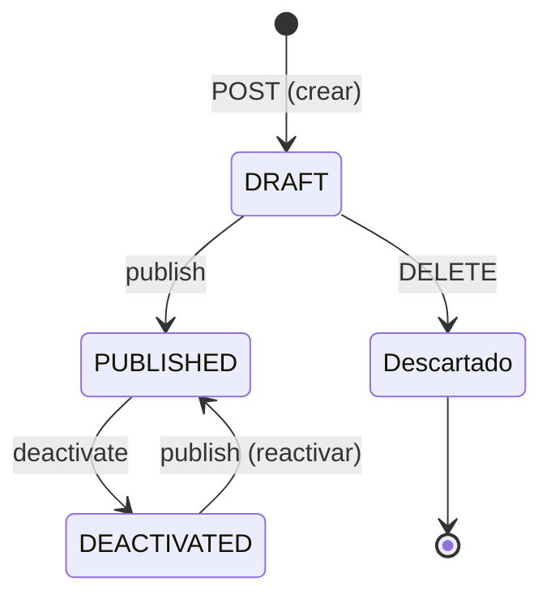

# Cofre

> Oferta de la tienda a precio fijo que entrega un premio al azar entre los que configuró el profesor. Hoy existen, en la fase 1 (solo premios de ítem), la gestión del profesor (crear, editar, publicar, desactivar y descartar) y la vista del alumno (listado y detalle de los cofres publicados). La compra con sorteo todavía no existe.

## Qué representa
El profesor arma un cofre para su curso con un precio en monedas y una lista de premios. Cada premio tiene una rareza (Común, Raro, Épico o Legendario) y cada rareza un peso. Al comprar, se sortea primero la rareza según los pesos y después un premio dentro de ella ([[DEC-031 - Cofres configurables con ítems, monedas y XP]], [[DEC-032 - Sorteo y reglas de configuración de los cofres]]).

Los cofres se construyen en dos fases ([[DEC-035 - Cofres en dos fases]]). La fase 1 solo admite premios de ítem, tomados de las ofertas del curso; la fase 2 suma monedas y XP. El backend de la fase 1 se adelantó al Sprint 3 ([[DEC-042 - Fase 1 de cofres en el Sprint 3]]). Lo que hay en el código es la US-12002 ([[S3-02 - Cofres, el profesor crea y gestiona]]) y la US-12003 ([[S3-03 - Cofres, el alumno ve los cofres del curso]]).

## Datos principales
Tablas `chests` y `chest_rewards`, creadas por la migración `src/main/resources/db/migration/V16__chests_schema.sql`. En el cable los campos van en `snake_case`.

**Cofre** (`entities/ChestEntity.java`):

| Campo | Significado |
|---|---|
| `chest_id` | Identificador (`Long`, en la base `id BIGSERIAL`) |
| `course_id`, `created_by` | Curso y profesor que lo creó |
| `name`, `description` | Nombre de 1 a 50 caracteres (el mismo límite que una oferta, `CatalogOfferLimits.MAX_NAME_LENGTH`; la columna admite 150) y descripción opcional de hasta 500 |
| `coin_price` | Precio en monedas, entero de 1 a 999.999, como el de una oferta ([[DEC-028 - Precio de oferta hasta 999.999 monedas]]) |
| `status` | `DRAFT`, `PUBLISHED` o `DEACTIVATED` (`models/enums/ChestStatus.java`) |
| `rarity_weights` | Peso de cada rareza (`common`, `rare`, `epic`, `legendary`). Por defecto 60 / 25 / 12 / 3 (`ChestEntity.DEFAULT_WEIGHT_*`). Enteros de 0 a 1000: el máximo es un tope técnico del código (`ChestLimits.MAX_RARITY_WEIGHT`), para que la suma del sorteo no desborde |
| `show_probabilities` | Si el alumno ve las probabilidades antes de comprar. Encendido por defecto ([[DEC-035 - Cofres en dos fases]]) |
| `purchase_limit` | Opcional: `max_per_student` (entero positivo, sin máximo) y `period` (`DAY`, `WEEK` o `COHORT`, `models/enums/ChestLimitPeriod.java`). Van los dos o ninguno: la V16 lo exige con `chk_chest_limit_pair`. Sin límite, no hay tope por alumno. Cuándo empieza cada período: [[DEC-045 - Período del límite de compras de un cofre]] |
| `deleted` | Descarte lógico de un borrador |
| `version` | Versión optimista (`@Version`). La edición la exige y la respuesta la devuelve |
| `created_at`, `updated_at` | Fechas de alta y de última modificación |

**Premio** (`entities/ChestRewardEntity.java`):

| Campo | Significado |
|---|---|
| `prize_id`, `position` | Identificador y orden dentro del cofre |
| `reward_kind` | `ITEM`, `COINS` o `XP` en el enum (`models/enums/ChestRewardKind.java`). En la fase 1 solo se acepta `ITEM`: la API rechaza los otros dos y el CHECK `chk_chest_reward_kind` de la V16 tampoco los admite |
| `rarity` | Rareza elegida (`models/enums/ChestRarity.java`). Si el pedido no la trae, se guarda la sugerida |
| `suggested_rarity` | Solo en la respuesta: la rareza que sugiere Mercado |
| `probability` | Solo en la respuesta: porcentaje con 2 decimales. El profesor la ve siempre; el alumno, solo si `show_probabilities` está encendido |
| `source_offer_id` | Oferta del curso de la que se copió. Es solo procedencia: no tiene clave foránea |
| `item_value` | Precio de la oferta en el momento de copiarla. Sirve para sugerir la rareza y calcular los avisos |
| Copia del ítem | `AuctionItemSnapshot` embebido (columnas `item_*`), el mismo que usan las subastas: plantilla, nombre, descripción, tipo, cargas, alcance, multiplicador, modo de boost, duración, intentos, regla de consumo y vidas. No copia precio ni stock (`entities/AuctionItemSnapshot.java`, `fromOffer`) |
| `deleted` | Premio quitado al editar. No se borra porque las órdenes de la compra (US-12004) lo van a referenciar |

## Ciclo de vida / estados

- Todo cofre nace como borrador.
- **Publicar** se puede desde `DRAFT` y desde `DEACTIVATED`; desde `DEACTIVATED` es reactivar. Exige al menos un premio y que alguna rareza con premios tenga peso. No vuelve a leer las ofertas: la copia ya está congelada.
- **Desactivar** solo se puede desde `PUBLISHED` y no toca los premios.
- **Descartar** solo se puede con un borrador. Marca `deleted` en el cofre y en sus premios. Después, el cofre responde 404 en todas las rutas.
- Cualquier otra transición responde 409 `chest-state-conflict`.

Están en `services/impl/ChestManageServiceImpl.java` y documentadas en `services/ChestManageService.java`. La entidad no tiene métodos de transición: el servicio cambia `status` y `deleted`.

## Reglas de negocio

### Premios de la fase 1
- Al menos un premio, como máximo 100 ([[DEC-040 - Tope técnico de 100 premios por cofre]]). Un premio de monedas o de XP responde 400 en `prizes[i].reward_kind`.
- Cada premio de ítem necesita `source_offer_id`, una oferta del mismo curso que no esté borrada. Se aceptan ofertas inactivas, vencidas y agotadas, y los cuatro tipos de ítem, vidas incluidas (`services/impl/ChestPrizeResolver.java`).
- Una oferta inexistente, de otro curso, borrada o con la configuración incompleta responde 400 en ese premio, con todos los premios fallidos juntos. El 404 queda para el cofre de la ruta.
- La misma oferta puede repetirse en varios premios, sin aviso.

### Copia congelada sin consumir stock
Cumple [[DEC-032 - Sorteo y reglas de configuración de los cofres]]: al agregar una oferta como premio, el cofre copia su configuración y su precio en una sola consulta de lectura. El stock de la oferta nunca se toca. Si después la oferta se edita, se desactiva o se borra, el premio no cambia. Al editar un cofre, los premios de una misma oferta conservan su copia ([[DEC-041 - Edición de un cofre según su estado]]).

### Rareza sugerida
`ChestRules.suggestRarity` (`services/impl/ChestRules.java`) compara el valor del premio con el precio del cofre, con aritmética entera exacta:

| Valor ÷ precio | Rareza sugerida |
|---|---|
| menor que 1 | `COMMON` |
| de 1 a menos de 1,5 | `RARE` |
| de 1,5 a menos de 2,5 | `EPIC` |
| 2,5 o más | `LEGENDARY` |

El profesor puede elegir otra. Si un premio llega sin rareza, se guarda la sugerida. En un borrador, al editar se vuelve a calcular con el precio nuevo para los premios que vienen sin rareza.

### Probabilidades
`ChestEvaluator` (`services/impl/ChestEvaluator.java`) reparte el peso solo entre las rarezas que tienen premios. La probabilidad de un premio es el peso de su rareza dividido por la suma de los pesos de las rarezas con premios y por la cantidad de premios de esa rareza. Si ninguna rareza con premios tiene peso, el cofre se rechaza con 400 en `rarity_weights`.

El redondeo está en [[DEC-044 - Redondeo de las probabilidades de un cofre]] (`services/impl/ChestProbabilityRounding.java`): 2 decimales, mayor resto para que cada cofre sume exactamente 100,00 y un mínimo de 0,01 descontado del premio más probable. Lo ven igual el profesor y el alumno. Es solo para mostrar: el sorteo de la compra (US-12004) usa los pesos exactos.

### Avisos que no bloquean
Cumplen la libertad del profesor de [[DEC-031 - Cofres configurables con ítems, monedas y XP]]: la respuesta trae `warnings[]` con `{code, message, prize_position, rarity}` y el cofre se guarda igual. Códigos estables (`models/enums/ChestWarningCode.java`):

| Código | Cuándo |
|---|---|
| `PRIZE_WORTH_MORE_THAN_CHEST` | El valor de un premio es estrictamente mayor que el precio |
| `AVERAGE_RETURN_ABOVE_PRICE` | El valor esperado del cofre supera el precio |
| `LIFE_PRIZE_AT_CAP` | Un premio es una vida: un alumno en el tope la pierde ([[DEC-007 - Tope de vidas, Accounting decide y reporta]]). Uno por premio de vida |
| `PRIZE_CANNOT_BE_DRAWN` | El premio está en una rareza con peso 0 |
| `EMPTY_RARITY_WITH_WEIGHT` | Una rareza tiene peso y no tiene premios. No participa del sorteo |
| `OFFER_SOLD_OUT` | La oferta copiada no tiene stock disponible. Lo calcula `ChestPrizeResolver` solo al copiar: al crear el cofre y, en un borrador, para las ofertas que se copian al editar. No se recalcula al leer ni al publicar |

`OFFER_SOLD_OUT` no estaba en DEC-032: lo agregó el QA de la T04 (#12008).

### Edición y versión
Qué se edita en cada estado y cómo se conserva la copia está en [[DEC-041 - Edición de un cofre según su estado]]. En resumen:

- En un borrador se edita todo.
- En un cofre publicado o desactivado se editan nombre, descripción, precio, `show_probabilities` y el límite. Cambiar los pesos o los premios responde 409 `chest-state-conflict` con el campo (`rarity_weights` o `prizes`). Mandarlos iguales se acepta (`services/impl/ChestEditGuard.java`).

La edición es un PUT completo con `version`:
- **Valores omitidos:** omitir `show_probabilities` lo vuelve a encendido, omitir `purchase_limit` deja el cofre sin límite y omitir `rarity_weights` vuelve a 60 / 25 / 12 / 3. En un cofre publicado con pesos propios, omitir `rarity_weights` responde 409, porque cambiaría los pesos.
- **Versión:** sin `version` responde 400. Con una versión vieja responde 409 `chest-version-conflict`.
- **Carreras:** si otra escritura gana la carrera, también responde 409 `chest-version-conflict`.
- **Premios:** la versión sube aunque solo cambien los premios (`ChestEntity.markEdited()`).

Publicar, desactivar y descartar no reciben `version`. Ver *Pendientes*.

## API de gestión del profesor
Controlador `controllers/CourseChestManageController.java`, bajo `/api/market/courses/{courseId}/chests`. Todas las rutas piden `X-User-Id`.

| Método y ruta | Acceso | Respuesta |
|---|---|---|
| `POST /` | escritura | 201 con el cofre, sin `Location` |
| `PUT /{chestId}` | escritura | 200; PUT completo con `version` |
| `POST /{chestId}/publish` | escritura | 200; publica o reactiva |
| `POST /{chestId}/deactivate` | escritura | 200 |
| `DELETE /{chestId}` | escritura | 204; descarta un borrador |
| `GET /{chestId}` | lectura | 200 con la `version` que pide la edición |
| `GET /?page&size&status` | lectura | 200, página `{content, page}` |

- **Listado** (`services/impl/ChestQueryServiceImpl.java`):
  - Incluye los cofres no descartados de cualquier estado, o solo los del `status` pedido, ordenados por `updated_at` descendente.
  - `size` va de 1 a 100 (por encima se recorta a 100) y vale 20 por defecto.
  - Un `page` negativo, un `size` menor que 1, un `status` desconocido o un `page × size` que no entra en un `int` responden 400 en ese parámetro.
- **Lectura del cuerpo:** crear y editar validan con `@Valid` y leen en modo estricto. Un campo desconocido o un entero no exacto (`7.9`) responden 400 (`StrictJsonModule`, solo en los DTO de pedido de `dtos/chests`).
- **Errores:** `chest-invalid-parameters` (400, todos los errores juntos), `chest-not-found` (404), `chest-state-conflict` (409) y `chest-version-conflict` (409). Detalle en [[Errores de la API]].

### Autorización
Roles `PROFESSOR`, `ADMIN` y `GESTOR` en `@PreAuthorize`. La regla de negocio la aplica `services/impl/ChestAccessGate.java`, que el controlador llama antes de abrir la transacción del servicio. Así, las llamadas a Cursos no retienen una conexión de la base. El orden:

1. Sin `X-User-Id` → 403.
2. Mercado habilitado para el curso: vale también para el `ADMIN`.
3. El `ADMIN` no necesita estar asignado al curso.
4. El resto necesita la membresía docente de Cursos ([[DEC-021 - Acceso al mercado por membresía de Cursos]]):
   - Leer exige `PROFESSOR` o `PROFESSOR_READ_ONLY` con `can_read`.
   - Escribir exige `PROFESSOR` con `can_write`.
   - Un docente de solo lectura que escribe recibe 403.

La consulta de membresía se hace una sola vez por request ([[Integración con Cursos]]).

**El `GESTOR` en los cofres.** El rol pasa `@PreAuthorize`, pero una membresía `GESTOR` responde 403 `professor-not-assigned`, igual que en metas y ofertas. Es lo que pide [[DEC-021 - Acceso al mercado por membresía de Cursos]] y queda atado a [[Q-024 - Qué es el rol GESTOR]]. En las subastas, la PR #56 del vault, todavía abierta, propone tratar al `GESTOR` como docente (DEC-037). Si entra, el `GESTOR` va a tener permisos distintos en subastas y en cofres. El gate mira el rol de la membresía y no el del JWT: un JWT `GESTOR` con membresía `PROFESSOR` pasa.

## Vista del alumno
Controlador `controllers/CourseChestStudentController.java`, al lado de la tienda del alumno. Es la US-12003 ([[S3-03 - Cofres, el alumno ve los cofres del curso]]). Las dos rutas piden `X-User-Id`.

| Método y ruta | Respuesta |
|---|---|
| `GET /api/market/courses/{courseId}/catalog/chests` | 200, lista simple (sin paginar) de cofres; `[]` si no hay |
| `GET /api/market/courses/{courseId}/catalog/chests/{chestId}` | 200 con un cofre, el mismo DTO que el listado; 404 `chest-not-found` si no está publicado, es de otro curso, fue descartado, no existe o no se puede sortear |

El segmento literal `chests` le gana a `/catalog/{itemId}` de la tienda. Las rutas no declaran `produces`: un `Accept` que no es JSON responde 406 y no cae en la tienda.

**Qué ve el alumno** (`services/impl/ChestStudentQueryServiceImpl.java`, `mappers/ChestStudentMapper.java`, `dtos/chests/ChestStudent*Dto.java`):
- Solo cofres `PUBLISHED` no descartados del curso, ordenados por id.
- Del cofre: `chest_id`, `course_id`, `name`, `description`, `coin_price`, `show_probabilities`, `purchase_limit` y `prizes`. No ve los pesos.
- De cada premio: `prize_id`, `reward_kind`, `rarity`, `name`, `description`, `item_type` y `configuration`, tomados de la copia congelada. No ve `item_value` ni `source_offer_id`.
- `probability` viaja solo con el interruptor encendido, con escala fija de 2. Apagado, la clave no aparece.
- Los premios de una rareza con peso 0 no se muestran, con el interruptor encendido o apagado: nunca salen. El profesor los ve con el aviso `PRIZE_CANNOT_BE_DRAWN`.
- **Cofre que no se puede sortear** (publicado sin premios vigentes, o con todas las rarezas con premios en peso 0): se saltea en el listado con un `WARN` y su detalle da 404. Un cofre roto no rompe la página. Hoy no se puede producir por la API.
- **Cupo:** sin límite, `purchase_limit` viaja en `null`. Con límite trae `max_per_student`, `period` y `remaining_in_period`, que nunca pasa del máximo. Las compras se cuentan por el puerto `services/ChestPurchaseCounter.java` desde el inicio del período de [[DEC-045 - Período del límite de compras de un cofre]]. Hoy el único contador es `services/impl/NoChestOrdersPurchaseCounter.java` (0 compras, porque todavía no se puede comprar un cofre), así que `remaining_in_period` es igual a `max_per_student`. La #12018 lo reemplaza.

### Acceso del alumno
`@PreAuthorize` con `STUDENT`, `ADMIN`, `GESTOR` y `MS`, el mismo grupo que la tienda y la compra; `PROFESSOR` queda afuera (ve sus cofres en la gestión). La regla la aplica `services/impl/ChestStudentAccessGate.java`, que el controlador llama antes del servicio y fuera de su transacción:

1. `X-User-Id` en blanco → 403 `student-not-enrolled` para cualquier rol, sin consultar Cursos. Sin la cabecera, un servicio recibe 400 `missing-header` y un usuario 401 (lo corta el filtro del Gateway).
2. Mercado habilitado para el curso, también para `ADMIN` y `MS`. Si no, el mismo 403 que la tienda (`COURSE_MARKET_DISABLED`).
3. `ADMIN` y `MS` no necesitan matrícula.
4. El resto, `GESTOR` incluido, tiene que ser alumno del curso ([[DEC-021 - Acceso al mercado por membresía de Cursos]]).

Una sola regla para el listado y el detalle, y **el acceso va antes de buscar el cofre**: un no alumno recibe 403 con cualquier id, exista o no. Difiere de la tienda en dos puntos: la tienda busca primero en el detalle (404 antes que 403) y ahí deja pasar al `GESTOR` sin matrícula, lo que contradice DEC-021 ([[Q-024 - Qué es el rol GESTOR]]). Con Cursos caído responde 503 `course-service-unavailable`.

## Pendientes
Quedaron de las reviews y del QA de la US-12002. Están registrados, pero no se arreglaron:

- **`publish`, `deactivate` y `discard` no reciben `version`.** Una vista vieja puede publicar un borrador recién editado. Si la publicación pierde una carrera contra una edición, responde 409 `chest-version-conflict` aunque no mandó versión. El frontend tiene que releer el cofre.
- **`markEdited()` fuerza el aumento de versión.** Patiño sugirió `LockModeType.OPTIMISTIC_FORCE_INCREMENT` en la review de la PR 270. El diseño de la T05 lo descartó: Hibernate incrementa al commit, la respuesta saldría con la versión vieja y la versión podría subir dos veces.
- **`OFFER_SOLD_OUT` no se recalcula al leer.**
- **Un cofre corrupto en la base rompería toda la página del listado del profesor.** Hoy no se puede producir por la API. La vista del alumno lo saltea (ver *Vista del alumno*).
- **Fase 2:** `ChestPrizeMerger` agrupa por `source_offer_id` y fallaría con un premio sin oferta (monedas o XP).

Otros pendientes, que no son del dominio, están en [[S3-02 - Cofres, el profesor crea y gestiona]], [[S3-03 - Cofres, el alumno ve los cofres del curso]] y [[Estado actual del código]].

## Dónde vive en el código
Paquete base `src/main/java/ar/edu/utn/frc/tup/p4/`:

- **Modelo:** `entities/ChestEntity.java`, `entities/ChestRewardEntity.java`, `entities/AuctionItemSnapshot.java`, `repositories/ChestRepository.java`, `repositories/ChestRewardRepository.java`, `models/ChestLimits.java`, los enums `Chest*` de `models/enums/` y `models/chests/ChestEvaluation.java`.
- **Reglas:** `services/impl/ChestRules.java`, `ChestEvaluator.java`, `ChestPrizeResolver.java`, `ChestPrizeMerger.java` y `ChestEditGuard.java`.
- **Servicios:** `services/impl/ChestManageServiceImpl.java`, `ChestQueryServiceImpl.java` y `ChestAccessGate.java`. Del alumno: `ChestStudentQueryServiceImpl.java`, `ChestStudentAccessGate.java`, `ChestLimitPeriodResolver.java` y `ChestProbabilityRounding.java`, más el puerto `services/ChestPurchaseCounter.java`.
- **API:** `controllers/CourseChestManageController.java`, `controllers/CourseChestStudentController.java`, `dtos/chests/`, `mappers/ChestMapper.java` y `mappers/ChestStudentMapper.java`. Los ejemplos de OpenAPI están en `configs/SpringDocConfig.java` (`addChestExamples`).
- **Errores:** `exceptions/ChestInvalidParametersException.java`, `ChestNotFoundException.java`, `ChestStateConflictException.java` y `ChestVersionConflictException.java`.
- **Esquema:** `src/main/resources/db/migration/V16__chests_schema.sql`.

## Relacionado
[[Cofres y nuevos ítems]], [[Oferta de catálogo]], [[Subasta]] (comparte `AuctionItemSnapshot`), [[Meta colectiva]] (mismo criterio de copia de oferta), [[Tipos de item]], [[Q-033 - Nombres de campo en los errores de validación]].
