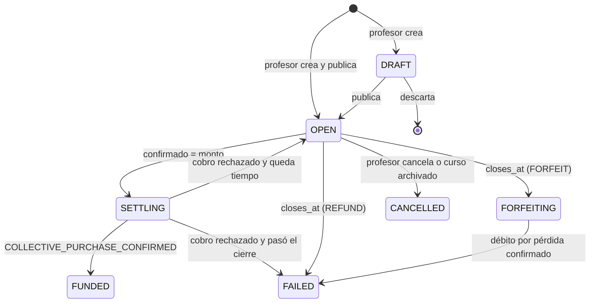
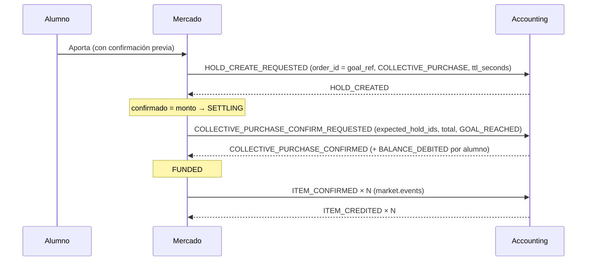

# Meta colectiva

> Modalidad de compra en la que los alumnos de un curso juntan monedas para un beneficio que define el profesor: un ítem para cada aportante o un beneficio externo. Está decidida en [[DEC-029 - Meta colectiva]] y no tiene código todavía; los detalles pendientes del contrato están en [[Q-026 - Detalles del contrato de la meta colectiva con Accounting]].

## Qué representa
El profesor publica una meta en su curso con un beneficio, un monto en monedas y una fecha de cierre. Cada alumno decide si aporta. La meta **se cumple en el momento en que se alcanza el monto**. Si llega el cierre sin alcanzarlo, **falla**, y las monedas se devuelven o se pierden según lo que eligió el profesor al crearla.

- **Ítem de la plataforma:** lo reciben solo los aportantes, una unidad cada uno.
- **Beneficio externo** (un punto extra, posponer un examen): la plataforma cobra y avisa, y el profesor lo reparte por su cuenta, incluso a quienes no aportaron.

## Datos principales
| Campo | Significado | ¿Editable después del primer aporte? |
|---|---|---|
| `title`, `description` | 1 a 150 y hasta 500 caracteres | Sí |
| `benefit_type` | `ITEM` o `EXTERNAL`, nunca los dos | No |
| Ítem | Copia de una oferta del curso (`source_offer_id`) o de una plantilla. Se valida igual que una oferta. Solo `SHIELD` y boosts `PER_EXAM` | No |
| Ícono del ítem | `icon_tier` e `icon_variant` copiados de la oferta de origen en columnas propias, no dentro de `item_configuration` ([[DEC-046 - El profesor elige forma y color del ícono del ítem]]; sin código en `develop@b195eee25`) | No: editar la oferta no cambia la copia |
| Beneficio externo | Título y descripción | No |
| `target_amount` | Monto de la meta, > 0 | Solo para bajarlo |
| `contribution_mode` | `FREE` (monto libre) o `FIXED` (cuota fija, una sola vez) | No |
| `min_contribution`, `max_per_student` | Solo en `FREE`, opcionales | El mínimo solo para bajarlo, el tope solo para subirlo |
| `fixed_amount` | Solo en `FIXED` | No |
| `closes_at` | Hasta 2 meses después de la publicación | Solo para extenderlo, sin pasar ese máximo |
| `on_failure` | `REFUND` (por defecto) o `FORFEIT` | Solo de `FORFEIT` a `REFUND` |

Si al bajar el monto la meta queda igual a lo confirmado, se cumple en ese momento.

## Ciclo de vida / estados


Cada alumno tiene **un aporte por meta**, con su propio estado:

```
HOLD_REQUESTED → HELD → (INCREASE_REQUESTED → HELD)*
HOLD_REQUESTED → REJECTED          (Accounting rechazó el primer aporte)
HELD → CHARGED                     (meta cumplida o pérdida)
HELD → RELEASED                    (fallo con devolución, cancelación, baja o hold tardío)
Metas con ítem: ITEM_REQUESTED → ITEM_CREDITED | ITEM_FAILED (por plazo, porque Accounting no avisa la falla)
```

El cierre lo ejecuta una sola instancia, con [[Bloqueo optimista]]. Un job cierra las metas vencidas y, al arrancar, Mercado retoma las que quedaron en `SETTLING` o `FORFEITING`.

## Reglas de negocio
**Aportes**
- Aportar es voluntario. El monto real lo calcula el backend (D13): `faltante = target_amount − comprometido`.
  - En `FREE`: `real = min(pedido, max_per_student − aportado, faltante)`.
  - En `FIXED`: `real = min(fixed_amount, faltante)`.
  - Si el resultado es 0, se responde `409`.
- El último aporte paga solo lo que falta, también en cuota fija (D8). El mínimo no aplica al último aporte (D14).
- Los aportes se acumulan en monto libre (D6). No se retiran ni se reembolsan, y se confirman con un cartel previo que avisa si la meta tiene pérdida (D7).
- Cada alumno tiene un solo aporte en vuelo a la vez (D15). Cada aporte lleva una clave de [[Idempotencia]].
- **Comprometido y confirmado (D15).** El comprometido incluye los aportes en vuelo y evita que la meta se pase. El confirmado (los holds que Accounting ya creó) es lo que se muestra y lo que decide si la meta se cumplió. Se calcula con la meta bloqueada.

**Cierre**

| Situación | Estado | Monedas |
|---|---|---|
| Lo confirmado llega al monto | `SETTLING` → `FUNDED` | Cobro atómico a todos y después un `ITEM_CONFIRMED` por aportante, o el aviso del beneficio externo |
| `closes_at` con `REFUND` | `FAILED` | Un `HOLD_RELEASE_REQUESTED` por hold |
| `closes_at` con `FORFEIT` | `FORFEITING` → `FAILED` | Cobro atómico con un débito por pérdida propio |
| El profesor cancela, o el curso se archiva | `CANCELLED` | Se devuelve todo, sin pérdida (D11, D24) |
| Un aportante se da de baja | Sigue igual | Accounting libera su hold y Mercado resta el aporte (D21) |
| Se rechaza el cobro en lote | `OPEN`, o `FAILED` si ya pasó el cierre | Nadie pagó; se recalcula (D25) |
| Llega un hold después de cerrar | — | Se libera, nunca se cobra (D25) |

**Visibilidad (D16):** el alumno ve el total, el porcentaje, la cantidad de aportantes y su propio aporte. El profesor además ve la lista de aportantes, con los montos solo en `FREE`, y quiénes no aportaron.

## Flujo con Accounting
Mapa de tópicos y mensajes en [[Integración con Accounting#Meta colectiva]].



- **Orden invertido respecto de la compra directa:** primero se cobra y después se entrega, a diferencia de [[DEC-025 - Saga de compra de ítems según la Propuesta C]]. El motivo está en [[DEC-029 - Meta colectiva]].
- **Fallo con devolución y cancelación:** un `HOLD_RELEASE_REQUESTED` por hold.
- **Fallo con pérdida:** el mismo cobro en lote, con `settlement: GOAL_FORFEITED`.
- **Baja de un aportante y curso archivado:** Accounting libera los holds solo, con `HOLD_RELEASED` (`ACCOUNT_DEACTIVATED`, sin `correlation_id`). En el archivado, Mercado escucha `COURSE_COHORT_ARCHIVED` en `courses.events` solo para marcar la meta como `CANCELLED`.
- **Extender el cierre:** un comando nuevo de Accounting que extiende los holds de la orden (D20). Mientras no exista, no se puede extender una meta que ya tiene aportes.

## Dónde vive en el código
No existe en `tpi-market` (`ac05a77f`). Lo previsto:
- **Datos:**
  - `goal`: id `Long` y `goal_ref` UUID, que se manda como `order_id`.
  - `goal_contribution`: único `(goal_id, student_id)`.
  - `goal_contribution_request`: la idempotencia.
- **API**, con prefijo `/api/market/courses/{courseId}/goals`:
  - El profesor crea, edita, publica, cancela y descarta metas, y consulta la lista de aportantes.
  - El alumno lista las metas, ve el detalle y aporta (`POST …/{goalId}/contributions`, que responde `202` con el monto real).
- **Mensajería.** Lo que existe hoy está armado solo para órdenes de compra:
  - `BankHoldRequestDto` no tiene `ttl_seconds`.
  - No se publica `HOLD_INCREASE_REQUESTED` ni se procesa `HOLD_INCREASED`.
  - `SagaCorrelationService` resuelve las respuestas a un id de orden `Long`.
  - El relay pone la key por alumno solo en las filas de orden.
  - `AccountingHoldEventHandler` busca el `hold_id` solo en `orders`.
  - No hay listener de `courses.events`.

## Dependencias fuera de Accounting
- **Cursos:** la lista de alumnos del curso, para los avisos a todo el curso y para la vista del profesor ([[Integración con Cursos]]).
- **Notificaciones:** tipos de evento nuevos para la publicación, el aviso de 24 h y el resultado ([[Integración con Notificaciones]]).

## Qué sirve también para subastas
La [[Subasta]] y la meta comparten temporalidad, muchos alumnos actuando sobre la misma entidad e ítems valiosos. Conviene construir estas piezas una sola vez:

| En la meta | En la subasta |
|---|---|
| Holds que vencen junto con el cierre, y el comando de extensión (D20) | Cualquier extensión del cierre necesita extender los holds de los postores |
| Job de cierre de una sola instancia, que retoma al arrancar | El cierre por tiempo y la recuperación de cierres a medias |
| Entidad bloqueada o con `@Version`; recorte y validación en el backend | La puja mínima y el incremento se validan con el estado bloqueado |
| Un solo pedido en vuelo por alumno; soportar `HOLD_INCREASE` en Mercado | Una puja en vuelo por postor |
| Monto comprometido y confirmado | La puja más alta visible es la que Accounting ya confirmó |
| Aportes irrevocables con confirmación previa | Pujas irrevocables con el mismo cartel |
| Devoluciones de a un hold | Liberación de cada postor perdedor ([[DEC-014 - Reglas de subastas]]) |
| Cobrar primero restringe los tipos de ítem (D28) | Mismo riesgo: sin vidas ni boosts por tiempo |
| Copia del ítem en la entidad (D27) | Editar la oferta original no afecta la subasta |
| Resolver `HOLD_RELEASED` por `hold_id` en cualquier entidad | Un solo resolvedor para órdenes, aportes y pujas |
| Escuchar `COURSE_COHORT_ARCHIVED` | Cancela metas y subastas |
| Editar solo a favor del alumno (D12) | Una subasta publicada no empeora sus condiciones |
| Avisos de publicación, 24 h y cierre | Las subastas ya tienen contrato con Notificaciones (`AUCTION_STARTED`, `AUCTION_CLOSED`, `AUCTION_CANCELLED`) |

## Relacionado
[[DEC-029 - Meta colectiva]], [[Q-026 - Detalles del contrato de la meta colectiva con Accounting]], [[Integración con Accounting]], [[Hold de monedas]], [[Subasta]], [[Saga]], [[Patrón Outbox]], [[Meta colectiva (Colecta)]] (propuesta anterior, archivada).
