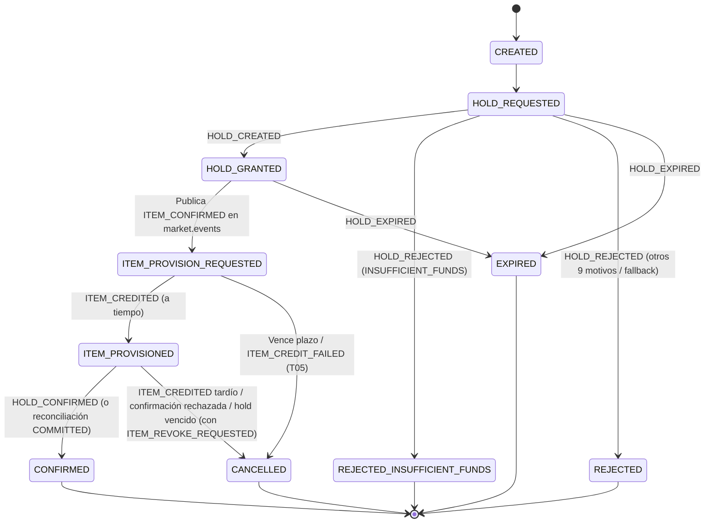

# Orden de compra

> Registro de un intento de compra de un estudiante. Avanza por una máquina de estados que refleja la [[Saga]] adoptada en [[DEC-025 - Saga de compra de ítems según la Propuesta C]]: retener fondos, acreditar el ítem (`ITEM_CONFIRMED` → `ITEM_CREDITED`), y confirmar el débito (`HOLD_CONFIRM_REQUESTED` → `HOLD_CONFIRMED`), con compensación simétrica mediante revocación ante fallos.

## Qué representa
Una compra en curso o terminada: quién compró, qué oferta, a qué precio y cómo terminó. El cliente la ve como `PROCESSING` hasta que concluye.

## Datos principales
| Campo | Significado |
|---|---|
| `orderRef` | UUID canónico de la orden (columna `order_ref`, restricción única `uk_orders_order_ref`, `updatable = false`). Lo asigna `PurchaseOrderServiceImpl` al crearla; si falta, `@PrePersist` y `requestHold` lo generan. Es el `orderId` que Mercado envía a Accounting; el `id` numérico sigue siendo el que ve el cliente HTTP |
| `courseId`, `studentId`, `offerId` | Contexto de la compra |
| `itemType` | Tipo de ítem copiado de la oferta al crear la orden; evita leer la oferta al confirmar. Nulo en órdenes anteriores al PR #82 (ver [[Estado actual del código]]) |
| `appliedPrice` | Precio congelado al comprar |
| `status` | Estado actual (`OrderStatus`) |
| `holdId`, `holdExpiresAt` | Hold de Accounting y su vencimiento ([[Hold de monedas]]) |
| `stockReservationId` | Reserva de stock |
| `cancellationReason` | Motivo tipado de cancelación (`OrderCancellationReason`): `CONFIRMATION_DEADLINE_EXCEEDED` (US-7697 T03, PR #182) y `ITEM_CREDIT_FAILED` (US-7697 T05, PR #188 en `develop@d3b7a4de`). Filas históricas conservan `ITEM_PROVISION_FAILED` o `HOLD_NOT_SETTLED` |
| `reviewReason` | Causa de revisión administrativa (`OrderReviewReason`, columna `review_reason` en la tabla `orders`): `HOLD_VERIFICATION_UNRESOLVED` (consulta no resuelta tras ventana de gracia de 600 s), `REVOKE_IDENTITY_UNRESOLVED` (orden histórica sin UUID para revocar), `ITEM_REVOKE_FAILED` (T05, PR #188 en `develop@d3b7a4de`) y `LIFE_CREDIT_SHORTFALL` (T08, PR #187 en `develop@d3b7a4de`). Expuesto en HTTP en `review_reason` (omitido si es nulo) |
| `revokeFailed` | Bandera booleana independiente (columna `revoke_failed` en la tabla `orders`). Se establece en `true` vía `PurchaseReviewService.markRevokeFailed` al fallar la revocación (T05, PR #188), garantizando que quede registrada la falla incluso si la orden ya tenía otro motivo de revisión asignado |
| `rejectionReason` | Motivo tipado del rechazo del hold (`OrderRejectionReason`, columna `rejection_reason`). Persistido mediante `reject(OrderRejectionReason)` para los 10 motivos de Accounting o fallback `PROVISION_FAILED` (DEC-009, US-5193 T07, `f7457882`) |
| `idempotencyKey`, `requestFingerprint` | Evitan cobros duplicados ([[Idempotencia]]) |
| `version` | Control de concurrencia ([[Bloqueo optimista]]) |

## Ciclo de vida / estados

`PROCESSING` es solo el nombre HTTP de `CREATED`; nunca se persiste. Estados terminales: `CONFIRMED`, `REJECTED_INSUFFICIENT_FUNDS`, `REJECTED`, `CANCELLED`, `EXPIRED`. Los estados `ITEM_PROVISION_REQUESTED` ("esperando `ITEM_CREDITED`") e `ITEM_PROVISIONED` ("acreditado, esperando confirmación del hold") se mantienen como costuras internas para preservar la compatibilidad del esquema PostgreSQL sin alterar el enum (`ddl-auto=update` no modifica restricciones `CHECK`).

## Reglas de negocio
- **Saga adoptada para ítems directos ([[DEC-025 - Saga de compra de ítems según la Propuesta C]]):** Se retiene el dinero (`HOLD_CREATED`), se emite `ITEM_CONFIRMED` hacia `market.events` (despachado por `ItemProvisionDispatcher` en el PR #151, US-5193 T05), se espera en `ITEM_PROVISION_REQUESTED`, al recibir `ITEM_CREDITED` (procesado por `AccountingItemCreditedEventHandler` en el PR #151, US-5193 T06) se transiciona a `ITEM_PROVISIONED` y se emite `HOLD_CONFIRM_REQUESTED`, y con `HOLD_CONFIRMED` pasa a `CONFIRMED`.
- **Plazos de confirmación y reconciliación:** Para compras directas de ítems, el plazo de corte para confirmar es `holdExpiresAt - 90 s`. El job de chequeo de deadlines (`purchase.confirmation-deadline.*`, habilitado por defecto, intervalo 15 s, lote de 50) consulta `GET /api/accounting/holds/{holdId}`:
  - `COMMITTED`: confirma la orden (`CONFIRMED`).
  - `PENDING` o `RELEASED`: ejecuta compensación atómica (`CONFIRMATION_DEADLINE_EXCEEDED`).
  - `UNKNOWN`, caída de red o error de identidad: reintenta hasta el vencimiento efectivo más 600 s. Agotado el plazo, marca para revisión con `HOLD_VERIFICATION_UNRESOLVED` (`review_reason`), deteniendo reintentos y preservando el estado y las reservas.
- **Rollback completo con revocación:** Ante vencimiento de plazo, confirmación rechazada o eventos autoritativos externos `HOLD_RELEASED`/`HOLD_EXPIRED`:
  1. Emite `ITEM_REVOKE_REQUESTED` `{correlation_id, order_id, student_id, course_id, revoke_reason: "PURCHASE_NOT_COMPLETED"}` con `order_id = orderRef` canónico (contrato congelado de Mercado en `snake_case` según `contratos-kafka v8`, pendiente de ratificación de Accounting).
  2. Emite `HOLD_RELEASE_REQUESTED` con motivo `PURCHASE_NOT_COMPLETED` (si no provino ya de una liberación remota).
  3. Libera el stock reservado localmente (`stockReservationId`).
  4. Cancela la orden (`CANCELLED`).
  5. Si la orden carece de `orderRef` UUID histórico, se escala a `REVOKE_IDENTITY_UNRESOLVED` sin compensar para no romper el inventario remoto ni inventar identidades.
- **Sustitución de DEC-019:** Para compras directas nuevas bajo la Propuesta C adoptada, DEC-025 sustituye a [[DEC-019 - La unidad de una compra HOLD_NOT_SETTLED queda retenida]]. En lugar de retener la unidad de stock de por vida en cuarentena, se revoca el ítem y se libera la unidad al catálogo. Se preservan las filas y reportes históricos de `HOLD_NOT_SETTLED`.
- **Flujo de compra de vidas vs. ítems:** La compra de vidas queda excluida de la revocación de ítems. Valida el tope preventivamente, retiene fondos, confirma el hold y emite `LIFE_PURCHASE_CONFIRMED` en `market.events`. En este sprint solo se detecta crédito parcial/insuficiente al consumir `LIFE_CREDITED` (T08, PR #187, mergeado en `develop@d3b7a4de`) y se marca para revisión de un ADMIN con `review_reason = 'LIFE_CREDIT_SHORTFALL'`; la saga completa de vidas queda diferida para el próximo sprint.
- **Cobrada sin acreditar (`SETTLED_UNCREDITED`):** si Accounting responde a `LIFE_PURCHASE_CONFIRMED` con `LIFE_PURCHASE_REJECTED` (`ACCOUNT_NOT_FOUND` o `ACCOUNT_INACTIVE`), la orden sigue en `CONFIRMED` y se marca con `settlement_mark = SETTLED_UNCREDITED` y `uncredited_reason` ([[S2-11 - Acuerdos de compra de vidas con Accounting]]).
- Ante hold vencido antes de entregar: `EXPIRED` y se libera stock. Accounting fija el TTL en 300 s para compras directas.
- Accounting exige un `order_id` UUID canónico y un hold por `order_id` para siempre. Mercado genera y persiste un `orderRef` UUID y lo usa como `order_id` ([[DEC-009 - Contrato de holds e ítems según Accounting]]). Implementado en `develop` (PR #88, US-5193): `OrderEntity.bankOrderId()` devuelve el `orderRef` como texto.
- El estudiante solo ve sus propias órdenes; las ajenas responden 404.
- Rechazos posibles (`OrderRejectionReason`): 12 valores en total (PR #110, US-5193 T07, `f7457882`). Los 10 motivos contractuales de Accounting más `LIFE_CAP_REACHED` y el fallback `PROVISION_FAILED`. En todos los rechazos se libera el stock reservado (`releaseStockIfReserved`).

## Dónde vive en el código
`models/enums/OrderStatus.java` (tabla de transiciones), `entities/OrderEntity.java` (`transitionTo`, `cancel`, `reject`, `bankOrderId`, `markForReview`), `models/enums/OrderCancellationReason.java`, `models/enums/OrderReviewReason.java`, `models/enums/OrderRejectionReason.java`, `services/impl/PurchaseOrderServiceImpl.java`, `OrderHoldServiceImpl.java`, `OrderItemProvisionServiceImpl.java`, `ItemProvisionDispatcher.java`, `OrderConfirmationServiceImpl.java`, `PurchaseRollbackServiceImpl.java`, `ConfirmationDeadlinePolicy.java`, `ConfirmationDeadlineGuard.java`, `PurchaseReconciliationSupport.java`, `PurchaseReviewService.java`, `listeners/AccountingHoldKafkaListener.java`, `listeners/AccountingItemCreditedEventHandler.java`, `dtos/accounting/ItemCreditedPayloadDto.java`, `dtos/events/ItemConfirmedPayloadDto.java`.

## Relacionado
[[Épica 137 - Compra directa]], [[DEC-025 - Saga de compra de ítems según la Propuesta C]], [[Propuesta C de la saga de compra]], [[Eventos y Kafka]], [[SSE]], [[Integración con Accounting]], [[DEC-019 - La unidad de una compra HOLD_NOT_SETTLED queda retenida]].
